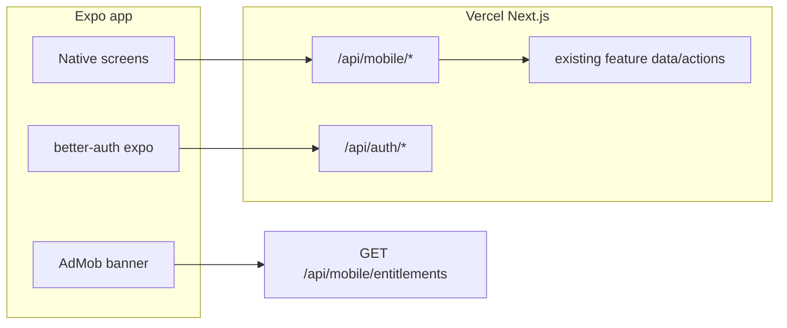

# تطبيق مصروفاتي Native كامل

الويب هو المصدر الوحيد للحقيقة. الموبايل الحالي ([mobile/app/index.tsx](mobile/app/index.tsx) + [mobile/app/login.tsx](mobile/app/login.tsx)) دخول + باقة فقط. **مفيش WebView** — كل شاشة Native، نفس الجلسة (`better-auth` + Expo SecureStore) ونفس MongoDB عبر Vercel `https://masrof-five.vercel.app`.

الويب شغّال بـ Server Actions. الموبايل محتاج **REST JSON** تحت `/api/mobile/*` بنفس منطق الـ actions (جلسة من `Cookie` زي [src/app/api/mobile/entitlements/route.ts](src/app/api/mobile/entitlements/route.ts)).

## هيكل التطبيق

Expo Router tabs + المزيد، مطابق [dashboard-shell.tsx](src/features/dashboard/components/dashboard-shell.tsx):

- تبويبات: الرئيسية · العمليات · العملاء · المشاريع · التقارير
- المزيد: حسابات · تصنيفات · ميزانيات · فواتير · أهداف · استيراد · نسخ احتياطي · خطتي · إعدادات · الفريق
- RTL عربي، ألوان `#065F46` / `#F3F0E8`
- إعلان AdMob أسفل الشاشة للمجاني فقط (`showAds` من entitlements)

ملفات أساسية نضيفها:

- `mobile/lib/api.ts` — عميل fetch + الكوكي
- `mobile/app/(app)/_layout.tsx` — شِل بعد الدخول
- `src/app/api/mobile/.../route.ts` — endpoints جديدة، تعيد استخدام `src/features/*/data.ts` وactions

## الدفعات (كل دفعة تنتهي بـ EAS preview APK)

**دفعة 1 — أساس يومي:** مساحة نشطة، ملخص الرئيسية (رصيد / دخل / مصروف الشهر)، قائمة عمليات + إضافة دخل/مصروف، الحسابات.

**دفعة 2 — فريلانس:** عملاء، مشاريع، فواتير (حالات + تعليم مدفوعة) + فتح طباعة A4/POS في المتصفح.

**دفعة 3 — تخطيط:** ميزانيات، متكرر، أهداف ادخار، تصنيفات، تحويل بين الحسابات.

**دفعة 4 — تقارير وإعدادات:** تقارير الفترة، تبديل المساحة، خطتي، هوية الفاتورة، فريق، استيراد CSV، نسخ احتياطي (مشاركة الملف).

**دفعة 5 — بلاي (لاحقاً، مش دلوقتي):** `eas.json` production AAB، أيقونة/خصوصية/حذف حساب، AdMob حقيقي بدل test IDs، Play Console.

Admin والموقع التسويقي يفضلوا ويب فقط.

## قواعد تقنية

- كل endpoint موبايل: `auth.api.getSession({ headers })` ثم نفس فحوصات workspace/plan الموجودة في الـ actions
- حدود الباقة المجانية تتنفّذ على السيرفر زي الويب
- رفع إيصال/لوجو عبر `/api/uploads/*` الموجودة
- OCR والتصنيف الذكي: استدعاء `/api/receipts/scan` و`/api/transactions/suggest-category` من الموبايل (برو)
- لا نعيد كتابة Mongoose models

## خارج النطاق الآن

رفع Google Play، دومين جديد، إيقاف Hostinger، دفع Paymob.